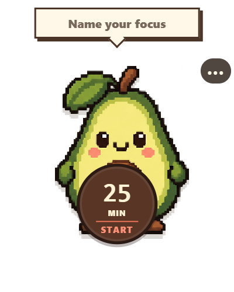
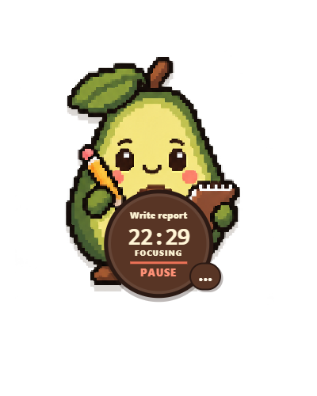

# Focus Timer

Focus Timer is a small Windows focus timer. The character is the clock, not decoration around a separate timer window.

| Ready | Focusing |
|---|---|
|  |  |

> Status: private beta. The core timer and local Markdown storage work, but the Windows release still needs manual accessibility, notification, sleep/wake, and soak testing.

## Download

There is no public download yet. Tested Windows builds will be published on the GitHub Releases page.

The finished app will not require Node.js, npm, Git, or a GitHub account.

## Features

- Named focus sessions from 1 to 240 minutes
- Pause, resume, cancel, and finish early
- Avocado, cat, dog, and tomato characters
- Always-on-top mode, enabled by default
- Recovery after an exit, crash, or restart
- Optional accomplishment notes
- Append-only daily Markdown files
- Independent sound and Windows notification settings
- No account, sync, telemetry, or runtime network access

## Using the app

1. Launch Focus Timer.
2. Choose an empty folder for your session records.
3. Enter a task and duration.
4. Select **Start**.
5. Use the clock to pause or resume.
6. When the timer ends, optionally record what you finished.

The app stores completed sessions in `YYYY-MM-DD.md` files. These are normal UTF-8 Markdown files and do not require Focus Timer to read.

## Data and privacy

Session history belongs to the user. Focus Timer never edits or deletes a finalized session record.

Back up the folder selected during setup. App settings and unfinished-session recovery data are stored under `%LOCALAPPDATA%\FocusTimer`.

Do not edit `focus-timer:session` markers while a failed save is waiting to be retried. The app blocks uncertain writes instead of risking a duplicate record.

## Development

Requirements:

- Windows 11 x64
- Node.js 24 or later
- npm 11 or later

```powershell
npm ci
npm run verify
npm run dev
```

## Build for Windows

```powershell
npm run package:win
```

Build output is written to `release/` and is not committed to Git. Current builds are unsigned, so Windows may show a SmartScreen warning.

## Tests

`npm run verify` runs TypeScript checks, 49 automated tests, and a production build.

Manual Windows checks are tracked in [docs/ACCEPTANCE_TESTS.md](docs/ACCEPTANCE_TESTS.md). They include accessibility, notifications, sleep/wake behavior, performance, network tracing, recovery testing, and an eight-hour soak.

## Project layout

- `src/core` - domain rules, validation, timing, and Markdown formatting
- `src/main` - persistence, filesystem access, timing, and Windows integration
- `src/preload` - restricted Electron IPC bridge
- `src/renderer` - React UI
- `tests` - automated tests
- `docs` - product, behavior, data, architecture, and acceptance specs

## Inspiration

The compact workflow was inspired by Tina Huang's Pixel Pomodoro demonstration. Focus Timer is an independent implementation with original code and original character artwork. It is not affiliated with or endorsed by Tina Huang.

## Contributing

See [CONTRIBUTING.md](CONTRIBUTING.md). Please report security issues through the private process in [SECURITY.md](SECURITY.md).
