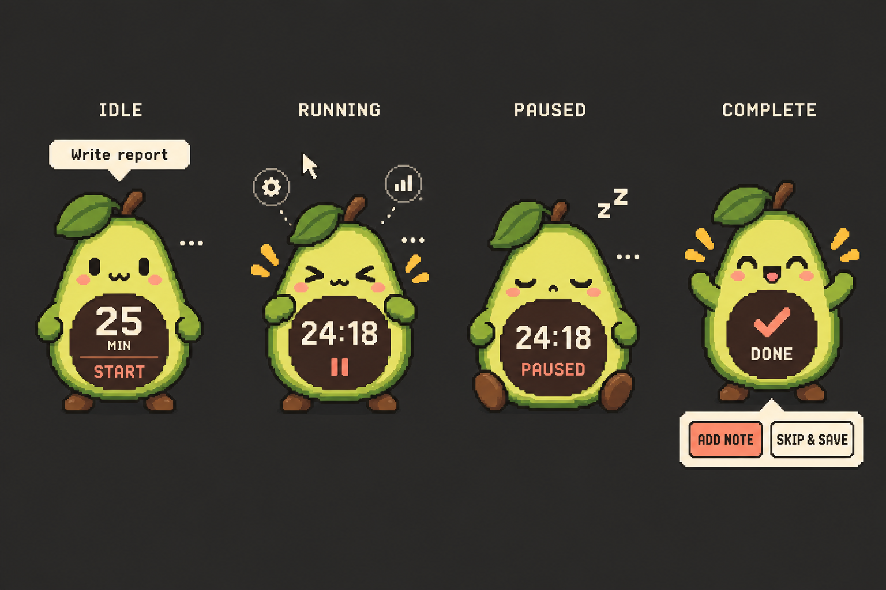
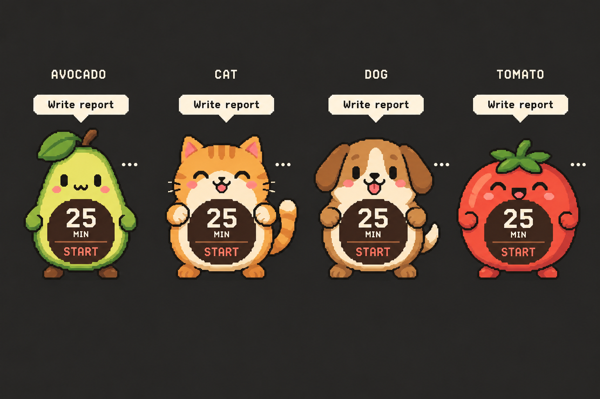

# Focus Timer — UX Flows

Status: **CONFIRMED** (Gate B character-first revision approved, 2026-10-13)

## Product form and visual language

The normal product is a transparent, frameless timer-character—not a rectangular application card containing a mascot. In `IDLE`, `RUNNING`, and `PAUSED`, the character occupies at least 85% of the visible nontransparent interface. Its belly, seed, badge, or central body feature is the live clock and primary action.

Compact mode targets 320×400 logical pixels and is fixed-size. The native taskbar entry and normal minimization remain. The character can be dragged from noninteractive body regions; its clock core and controls remain interactive. A small three-dot affordance is docked into the clock rim instead of occupying a detached side gutter.

Long-form and exceptional workflows use a panel visually attached to the character. The same BrowserWindow expands toward roughly 420×600 logical pixels, constrained to the current display work area. It does not open a separate settings or completion window.

Original avocado, cat, dog, and tomato skins share the same interaction hierarchy. Chunky shapes, crisp nearest-neighbor scaling, warm colors, visible focus rings, high-contrast fallbacks, and restrained motion create the playful character. Focused faces use soft brows, bright eyes, and a small confident smile so the companion feels supportive rather than judgmental. No Tina Huang or Pixel Pomodoro branding or artwork appears.

Concept direction—not production artwork:

## First launch

1. Open directly in attached-panel mode because setup is required.
2. Explain in one sentence that records belong to the user.
3. Select an empty or compatible folder.
4. Create/validate the marker.
5. Collapse into the compact idle character. Cancellation leaves `SETUP_REQUIRED` without creating records.

## Start flow

1. Compact idle shows a one-line task tab immediately above the character and duration/Start inside the clock core.
2. The task tab is a one-line editor, and the clock-core duration is an inline whole-minute editor.
3. Enter starts when both values are valid; inline validation explains the exact problem without relying on color.
4. Start acknowledgment appears only after recovery state is durable.
5. Skin selection remains a secondary menu action, not a permanent carousel competing with Start.

## Running and paused

- The external task tab disappears after Start. Its read-only label moves into the character's clock core above the dominant countdown, so task and time stay together without covering the face.
- The core remains on the lower body and is deliberately smaller than the face area. Long task labels clamp to two visual lines while the full value remains available to assistive technology and as a tooltip.
- Pause is primary; Finish early and Cancel are secondary and require confirmation.
- Pin/unpin, minimize, settings, skin, Finish early, Cancel, and Close are available from the contextual controls and announced accessibly.
- Paused state is unmistakable through the word `PAUSED`, control labels, and character treatment—not color alone.

## Completion

1. At zero, persist `COMPLETION_REVIEW`.
2. Attempt sound and notification once.
3. Show a brief celebration without taking focus from another application.
4. Expand an attached completion panel offering Add accomplishment or Skip & save.
5. Note entry autosaves within 500 ms and supports multiline Markdown.
6. Save success returns to idle. Failure remains unresolved and offers Retry.
7. The `Session saved.` confirmation fades and dismisses automatically after 2.4 seconds; it never captures pointer input.

## Recovery

- Resume directly into the durable state.
- If a running session expired while closed, enter completion review on launch and alert once if not previously attempted.
- A time conflict explains that the computer clocks disagree and offers two plain-language choices: use elapsed wall time, or pause at last verified progress.
- Corrupt primary recovery falls back to the backup. If both are unusable, preserve both files and present setup/recovery guidance; never silently discard them.

## Settings

Settings include skin, sound, notification, pinning, data folder, Open data folder, and a short statement that no runtime network or cloud account is used. Folder changes apply only to future records.

## Secondary controls

- A small three-dot affordance is always visible for discoverability.
- Activating the three-dot affordance expands the window upward and reveals Settings, Pin, Finish/Cancel when applicable, Minimize, and Close in one horizontal shelf above the character. Keyboard focus entering that set reveals it equivalently.
- The pin action uses the visible text `PIN`, is enabled on first launch, and remains highlighted while active. User changes are remembered.
- The character's bottom-center screen anchor does not move while the shelf opens or closes, so it can remain tucked against a screen corner.
- Controls close when the three-dot affordance is activated again or focus leaves, unless a confirmation is open. Ordinary character hover does not trigger a distracting control bloom.
- The reveal animation is short and disabled under reduced motion.
- Focus order is stable: task, clock core, menu, pin, finish/cancel when applicable, minimize, settings, close.

## Display, scaling, and pointer behavior

- Restore the remembered window position, then clamp enough of the character and its menu to the nearest visible work area.
- Temporary controls and attached panels expand around a remembered compact anchor. Closing settings/confirmation or saving a completed session returns to that exact compact position unless the display work area changed.
- Re-clamp after display removal, DPI changes, or expansion.
- At 100%, 150%, and 200% scaling, the compact character and all primary controls remain unclipped.
- The transparent window is tightly bounded to minimize invisible interception. Pixel-level click-through is an optional enhancement, not required behavior.
- High contrast may add an opaque outline or small backing halo around controls; it must not reconstruct the old full-window card.
